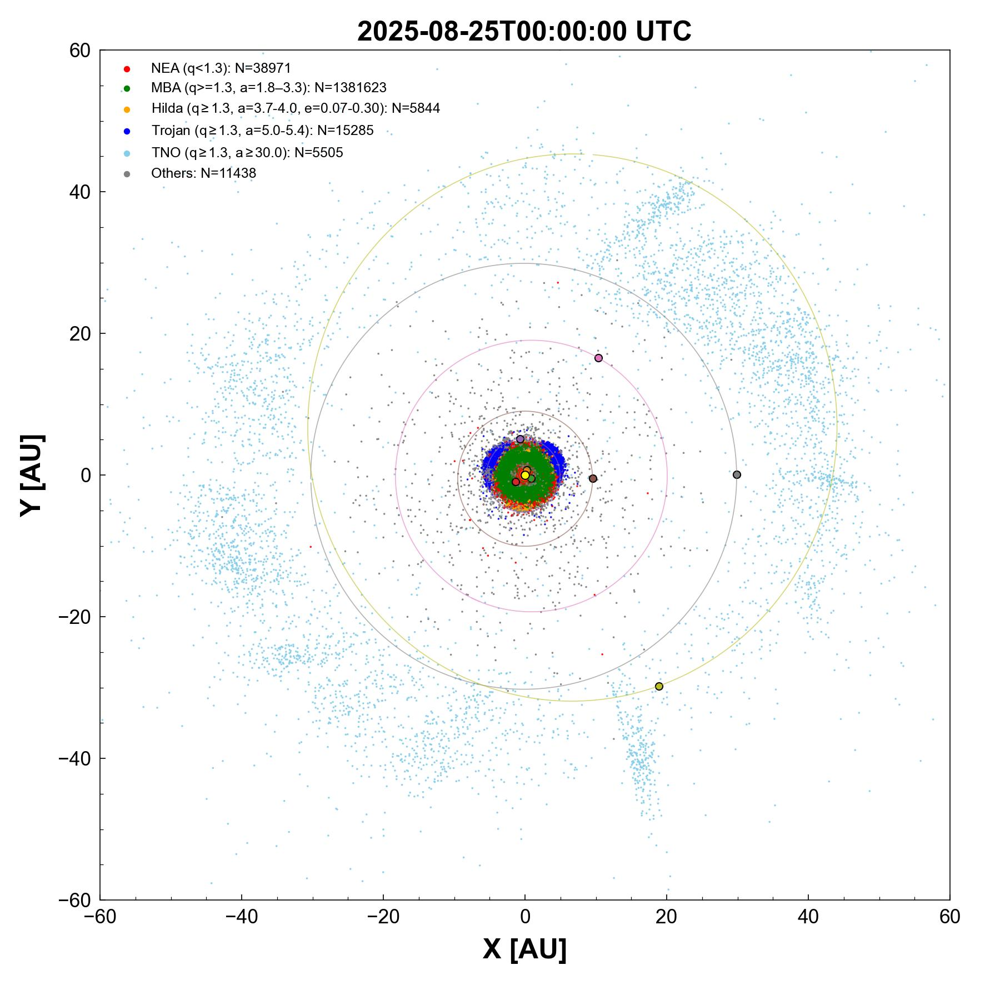
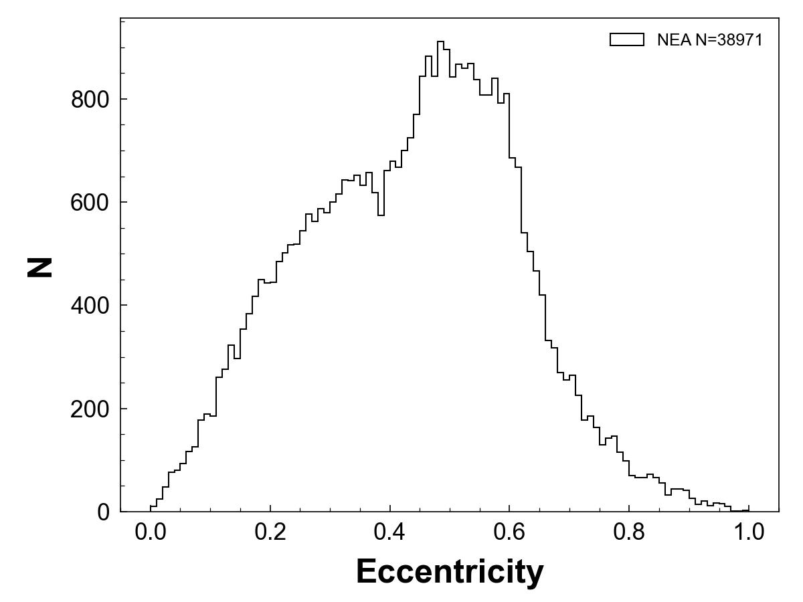
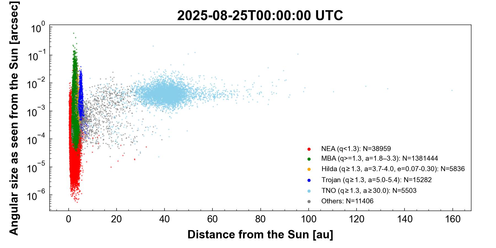

# Minor Planet Painter

[](https://opensource.org/licenses/MIT)

[Developer mail](mailto:jbeniyama@oca.eu)

## Overview

A Python library for plotting and visualizing minor planets.

## Structure

```text
./
  data/
  fig/
  minor_planet_painter/
    common.py
    ...
  scripts/
    plot_sssb_xy.py
    ...
  .gitignore
  README.md
```

## Set up

Clone the repository:

```bash
git clone https://github.com/jinbeniyama/minor-planet-painter.git
cd minor-planet-painter
```

Choose one of the following installation methods.

### Option 1: Using pipx (recommended for standalone CLI use)

If you have `pipx` installed:

```bash
pipx install --editable . --force
```

This installs the command-line tools in an isolated Python environment.

### Option 2: Using pip with a virtual environment (recommended)

Create and activate a virtual environment:

```bash
python -m venv .venv
source .venv/bin/activate
```

Install the package:

```bash
python -m pip install -e .
```

This is recommended if you want to use `minor_planet_painter` as a Python library or work with it alongside other scientific Python packages.

When you are finished, you can deactivate the environment:

```bash
deactivate
```

To use the package again, activate the environment:

```bash
source .venv/bin/activate
```

### Option 3: Using pip in an existing Python environment

If you already have a Python environment (e.g., a virtual environment for your research), you can install the package directly:

```bash
python -m pip install -e .
```

Make sure that you are using the intended Python environment before installing.

## Make figures

### 0. Preparation

- MPC

  Obtain orbital element datasets from the Minor Planet Center (MPC).
  Run the following command to download MPCORB.DAT (~300 MB) and NEAm00.txt automatically:

  ```bash
  wget-mpcorb-nea
  ```
  
  If the automatic download does not work, you can manually download `MPCORB.DAT` and `NEAm00.txt`, and save them in the `./data` directory as `MPCORB.DAT` and `NEAm00.txt`, respectively.


- LCDB

  You can download the data from the [LCDB website](https://minplanobs.org/MPInfo/php/lcdb.php).

  Download the latest data release, October 2023, from [here](https://minplanobs.org/MPInfo/datazips/LCLIST_PUB_CURRENT.zip).

  The input file used in this repository is `lc_summary_pub.txt`.

### 1. Spatial distribution of minor bodies

```bash
# Plot all minor planets (output figure is shown below)
plot_sssb_xy.py 2025-08-25 --range 60

# Plot all minor planets, only inner system
plot_sssb_xy.py 2025-08-25 --range 6

# Plot all minor planets specifying the input file
plot_sssb_xy.py --MPCORB MPCORB_original.DAT
```



### 2. Orbital elements of minor bodies

```bash
# Plot only NEAs (output figure is shown below)
plot_sssb_orbelem.py --onlyNEA

# NEA pairs (in prep.)
```



### 3. Angular distance of minor bodies

```bash
# Plot all minor planets (output figure is shown below)
# Note that this is from the Sun, not the Earth.
plot_sssb_angsize.py 2025-08-25 --out angsize_20250825.jpg
```



### 4. Sky motion of minor bodies

```bash
# Plot all minor planets (output figure is shown below)
# It takes a few minutes for only 500 bodies.
plot_sssb_skymotion.py --out skymotion_20250825.jpg --Nobj 500
```

<p align="center">
  <br>
  <em>Sky motion of minor bodies. The NEA with a semimajor axis of about 1 is (99942) Apophis.</em>
</p>

### 5. Psid vs. Psyn (in prep.)

```bash
plot_sssb_Psid_Psyn.py
```

### 6. Animation of the history of rotation period determinations

```bash
plot_lcdb_animation.py data/LCLIST_PUB_CURRENT_2023Oct/lc_summary_pub.txt
```

Note: We assume that the rotation period was determined in the year of discovery, based on the provisional designation. This is a reasonable assumption in most cases for small NEAs, but it is not necessarily correct. Suggestions for a better approach are very welcome.

<p align="center">
  <br>
  <em>History of rotation period determinations.</em>
</p>

### 7. Plot IRTF spectra

Download spectra from, e.g., the MITHNEOS website.

Then plot them with the following command:

```bash
plot_sssb_spectra.py data/asteroids_Binzel2019/Data_3.0_805/a000433.visnir.txt data/asteroids_Binzel2019/Data_3.0_805/a003200.visnir.txt --stype S B --plotcol "black" "grey"
```


